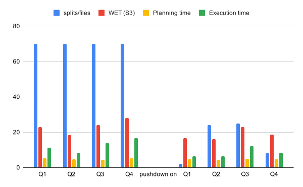
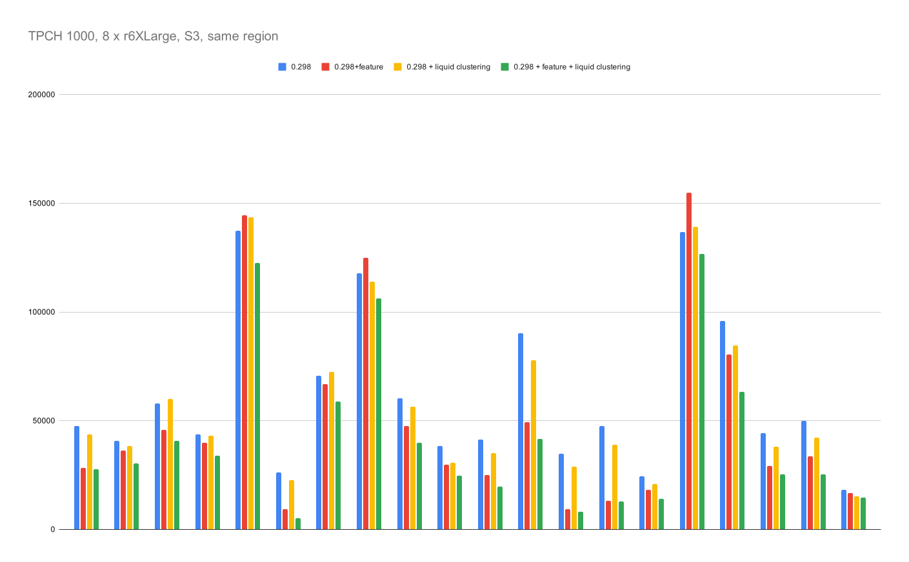

## RFC-0026: Delta Kernel predicate pushdown support

Proposers

* Miguel Blanco Godón (Denodo)

## Related Issues

Implementation PR: https://github.com/prestodb/presto/pull/28560

## Summary

Adds support for pushing down conditions to the Delta Kernel library to improve performance due to file skipping. This allows for efficiently querying tables with optimizations like Liquid clustering.

It also helps reduce the costs of querying data in lakehouse environments as fewer files are retrieved.

## Background

Liquid Clustering is an optimization for Delta tables, which is a feature that heavily benefits queries against the following scenarios:

* __Tables often filtered by high cardinality columns__: instead of creating millions of partition directories (partition explosion), the clustered columns are co-located inside flat files and queried efficiently through metadata statistics.
* __Tables with significant skew in data distribution__: skewed data can generate asymmetric partitions, which can impact negatively on the query performance if a partition holds up a significant amount of the total table data. For example, a table partitioned by 10 columns, where only one partition is responsible for 80% of the data.
* __Tables that grow quickly and require maintenance and tuning effort__: older legacy techniques are slower when tables grow as often involves sorting entire datasets. Liquid Clustering automatically optimizes each table change on each snapshot, reducing maintenance and tuning effort.
* __Tables with access patterns that change over time__: clustered columns can be changed dynamically in each version of the table, making it seamless change the access patterns while preserving/improving performance.
* __Tables where a typical partition column could leave the table with too many or too few partitions__: hive partitioning can create too many small files when cardinality is high, or massive un-skippable files when cardinality is too low. Liquid Clustering manages file size so that remain "optimal" regardless of column cardinality.

### Goals

* Improve query performance by pushing down predicates to the Delta Kernel library to skip the number of processed files.
* Reduce operational costs by retrieving fewer files from the lakehouse.


## Proposed Implementation

All the changes will be localized in the `presto-delta` submodule.

### Config changes

Add new properties to enable or disable the feature:
* Connector property
* Session property (priority)

### Metadata changes

Add metadata information to store if a column is clustered, just as made for the partitioned case:
* Add attributes and methods for this to `DeltaColumn`, `DeltaColumnHandle`, `DeltaColumnMetadataUtil` and `DeltaMetadata`.
* Add the properties `partitioned_by` and `clustered_by` to the `DeltaTableProperties` so that the `SHOW CREATE TABLE` command shows that information. That would align the behavior to other connectors (like Hive connector) and help users troubleshoot issues as they will be able to instantly see if a table is non-partitioned, non-clustered, partitioned or clustered.

### Coordinator changes

During the planning phase, where the snapshot info is retrieved, a table scan is built
* Add a class or classes to handle the  `TupleDomain` to Delta Kernel `Predicate` translation
* Filter the Delta Kernel scan to apply the given predicate

With these changes, less splits should be created and sent to workers (compared to the version prior to this feature).

### Split changes

Partitioned and clustered columns should be sent to the workers as split metadata. This is needed so that workers can determine how to process partitioned and clustered columns:
* Clustered columns are present in Parquet files, so they should be read as regular columns.
* Partitioned columns are not present in Parquet files, so they are processed in other way.

This and the metadata changes will also lay the foundation to add non hive-style parititioning partition pruning, which is currently unsupported (i.e. partitioned Delta tables with column mapping enabled, which don't use hive-style partitioning)


## Metrics

We can measure the impact of the feature by executing standardized benchmarks over Delta tables, like TPCH benchmark family.
We should see:
* Performance improvement on queries against non clustered data when using pushdown
* Performance improvement on queries against clustered data when using pushdown

We should take queries without pushdown against clustered and no clustered data as baseline.

### Benchmark

Here we present some benchmarks done after the initial implementation on the referred PR (https://github.com/prestodb/presto/pull/28560):

#### Skipped files benchmark

The following benchmark was executed in a debug environment (1 Presto coordinator and also worker) querying a 2.2GB table in S3. The data was in a different region that the Presto server. The Delta table was optimized with Liquid Clustering. Table stores fictional data of IoT devices, and 4 queries were used mirroring a "real" use case.

##### Queries:

Q1, pushdown = `(((column(event_date) = 20619) AND (column(region) = us-east-1)) AND (column(device_type) = thermostat))`:
```sql
SELECT 
  event_type,
  COUNT(*) AS event_count,
  ROUND(AVG(metric_value), 2) AS avg_metric,
  ROUND(AVG(temperature), 1) AS avg_temp
FROM lc_benchmark
WHERE event_date = date '2026-06-15'
  AND region = 'us-east-1'
  AND device_type = 'thermostat'
GROUP BY event_type
ORDER BY event_count DESC;
```

Q2, pushdown = `((column(event_date) >= 20635) AND (column(event_date) <= 20641))`:
``` sql
SELECT 
  event_date,
  region,
  COUNT(*) AS events,
  ROUND(AVG(metric_value), 2) AS avg_metric,
  ROUND(APPROX_PERCENTILE(metric_value, 0.95), 2) AS p95_metric
FROM lc_benchmark
WHERE event_date BETWEEN date '2026-07-01' AND date '2026-07-07'
GROUP BY event_date, region
ORDER BY event_date, region;
```
Q3, pushdown = `((column(event_date) >= 20666) AND (column(event_date) <= 20696))`:
```sql
SELECT 
  region,
  device_type,
  COUNT(*) AS total_events,
  APPROX_DISTINCT(user_id) AS unique_users,
  ROUND(AVG(temperature), 1) AS avg_temp,
  SUM(CASE WHEN event_type = 'alert' THEN 1 ELSE 0 END) AS alert_count,
  ROUND(AVG(battery_pct), 1) AS avg_battery
FROM lc_benchmark
WHERE event_date BETWEEN date '2026-08-01' AND date '2026-08-31'
GROUP BY region, device_type
ORDER BY total_events DESC;
```
Q4, pushdown = `(((column(event_date) >= 20690) AND (column(region) = eu-west-1)) AND (column(user_id) = 12345))`:
```sql
SELECT 
  event_ts,
  device_type,
  event_type,
  metric_value,
  temperature,
  battery_pct
FROM lc_benchmark
WHERE event_date >= date '2026-08-25'
  AND region = 'eu-west-1'
  AND user_id = 12345
ORDER BY event_ts DESC
LIMIT 50;
```

Legend:
* __Blue__: number of splits created. Each split represents processing a data file.
* __Red__: Wall Execution Time, total time upon query completion.
* __Yellow__: planning time of each query.
* __Green__: execution time of each query.




From the chart, we can see that the number of splits produced, and therefore files read, have decreased substantially. We can also see a decrease in query execution time without seeing a noticeable increase in query planning time.


#### TPCH 1000 benchmark

Tests executed against the TPCH-1000 benchmark, measuring total execution time per query. 8 nodes, 4 cores and 32 GB RAM each, Presto and Data in the same region. We tested the feature backported to 0.298.

Legend:
* __Blue__: Presto 0.298, without feature, non clusterized data.
* __Red__: Presto 0.298 with the feature backported, non clusterized data.
* __Yellow__: Presto 0.298, without feature, clusterized data.
* __Green__: Presto 0.298 with the feature backported, clusterized data.



We can see a general improvement of the execution times. Particularly:
* __Blue vs Green case__: -31% average reduction in execution time.
* __Yellow vs Green case__: -16% average reduction in execution time.

## Adoption Plan

The feature will be enabled by default. Existing users should not see any negative impact. They should in fact see a performance improvement.
However, both connector properties and session properties should be added in order to disable the feature:
* Connector property: `delta.kernel-predicate-pushdown-enabled`.
* Session property: `delta_kernel_predicate_pushdown_enabled`

The session property should have precedence over the connector property to dynamically change the pushdown behavior without having to restart Presto.

## Test Plan

In order to test this feature, we will need to implement:

### Unit tests

Unit tests cases:
* Predicate translation: translate the `TupleDomain` information to a Delta Kernel equivalent `Predicate`. Test this over all Presto types available in Delta.

### Integration tests

Integration tests cases:
* __File skipping__: apply the built predicate to a Delta scan. Test that file skipping is indeed applied with the feature enabled, and all files are retrieved with the feature disabled.
* __Queries behavior__: test queries with filters in the `WHERE` clause. Queries should return the same result with the feature enabled and disabled

### Performance tests

Performance tests should be conducted to validate the Goals:
* Less files are processed on e2e queries when the feature is enabled
* Query time decreases when the feature is enabled

### Additional test changes

Delta tables might have to be added in order to be able to test the feature over every supported Delta type.

## Current limitations

### Partial pushdown support

The following types have partial pushdown support:
* `BOOLEAN`: Delta does not store min-max stats for boolean types, which means that pushdown of `=`, `>=`, `>`, `<` and `<=` won't produce file skipping. Only pushdown of `IS NULL` or `IS NOT NULL` will result in file skipping.

### Unsupported types

The following types don't have pushdown support:
* Complex types: `ARRAY`, `STRUCT`, `MAP` types, cannot pushdown as no valid `TupleDomain` gets sent to the Delta connector upon a `WHERE` clause.
* `timestamp` and `timestamp with timezone` types: Presto does not handle timestamps with microsecond precision and the Delta Kernel library does not correctly parse ISO-8601 timestamps with microsecond precision. As we cannot detect these cases at runtime from the query predicate (Presto trims timestamps to millisecond precision and Delta throws `RuntimeExceptions` when parsing its own metadata) we must disable pushdown for now.
